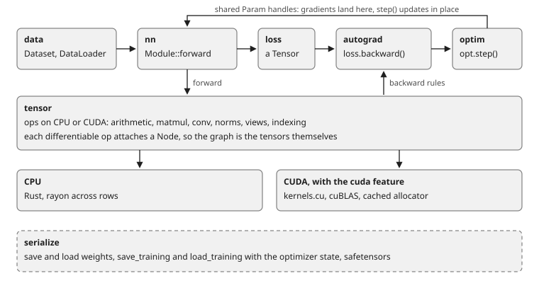

<div align="center">

# FastNN

**A robust deep learning library in Rust with CUDA kernels.**

[](https://github.com/CanReader/FastNN/actions/workflows/ci.yml)
[](https://crates.io/crates/fastnn)
[](https://docs.rs/fastnn)
[](https://github.com/CanReader/FastNN/blob/master/Cargo.toml)
[](LICENSE)

[Documentation](https://docs.rs/fastnn) · [Examples](examples) · [Releases](https://github.com/CanReader/FastNN/releases) · [Contributing](CONTRIBUTING.md)

</div>

FastNN trains neural networks in Rust. It has tensors with automatic
differentiation, the layers and optimizers behind MLPs, CNNs, RNNs and
transformers, data loading, and checkpoints a run can resume from. It runs on
the CPU out of the box and on NVIDIA GPUs with one feature flag.

The whole stack is in one crate, written to be read. You can follow
`loss.backward()` from your training loop down to the kernel. Every backward
rule is tested against finite differences of its own forward, every CUDA
kernel against the CPU path, and `unsafe` appears only in the CUDA bindings.

## Highlights

- **Autograd without a tape.** A tensor made by a differentiable op carries the
  rule that made it. `backward()` walks those links, and dropping the loss frees
  the graph. No `requires_grad`, no global state.
- **Built for long runs.** Checkpoints carry the optimizer state and the step,
  so a resumed run continues instead of restarting Adam. `detect_anomaly` stops
  at the op that produced a NaN. A frozen layer gets no gradient at all, not
  just one the optimizer ignores.
- **Transformers end to end.** Multi-head attention with causal and padding
  masks, encoder and decoder stacks, a KV cache for decoding, sampling with
  temperature, top-k and top-p, and beam search.
- **GPU with one flag.** `--features cuda` compiles the kernels in this
  repository and routes matmul through cuBLAS. The CPU build needs nothing but
  `cargo`.
- **Checkpoints other tools can read.** Safetensors in and out, with F16 and
  BF16 widened on load.
- **Checked against the maths.** `gradcheck` tests every backward rule against
  finite differences, `cuda_parity` runs every kernel against the CPU path, and
  `convergence` trains every layer family and optimizer on a small problem.

## Installation

```bash
cargo add fastnn                   # CPU only, no CUDA toolkit needed
cargo add fastnn --features cuda   # with the CUDA kernels
```

Needs Rust 1.87 or newer. With `--features cuda` you also need the CUDA toolkit,
11.8 or newer, for GPUs from Turing to Hopper (compute capability 7.5 to 9.0).

## Quick start

An MNIST training loop:

```rust
use fastnn::data::{Mnist, Split};
use fastnn::prelude::*;

fn main() -> Result<(), Box<dyn std::error::Error>> {
    let train = Mnist::load(Split::Train)?;
    let loader = DataLoader::new(&train, 128).shuffle(true);

    let model = Sequential::new()
        .add(Flatten::new())
        .add(Linear::new(784, 128))
        .add(ReLU)
        .add(Linear::new(128, 10));

    let mut opt = Adam::new(model.parameters(), 1e-3);

    for batch in loader.iter() {
        let loss = cross_entropy(&model.forward(&batch.inputs), &batch.labels());

        opt.zero_grad();
        loss.backward();
        opt.step();
    }

    save(&model, "mnist.fdl")?;
    Ok(())
}
```

To train on a GPU, move the model and the loader. The loop stays the same.

```rust
let device = Device::best();       // GPU if there is one, else CPU
model.to_device(device);
let loader = DataLoader::new(&train, 128).to_device(device);
```

The [documentation](https://docs.rs/fastnn) walks through the whole crate:
models, training, data, checkpoints, the GPU, generation and debugging.

## Examples

```bash
cargo run --release --example simple_mlp
cargo run --release --example mnist_cnn --features cuda
```

Use `--release`. Debug builds are about 50x slower.

| Example | What it shows |
|---|---|
| `simple_mlp` | MLP learning XOR, the smallest training loop |
| `mnist_mlp` | Dataset download, batching, evaluation, checkpointing |
| `mnist_cnn` | Convolutions, batch norm, pooling, an LR schedule |
| `char_lm` | Small GPT trained from scratch, resumes after Ctrl-C |
| `finetune` | Pretrain, freeze the backbone, train a new head |
| `gan` | Two networks trained against each other |
| `vae` | Variational autoencoder on 2-D data |
| `reinforce` | Policy gradient on a bandit |
| `multi_task` | Shared trunk, two heads, one combined loss |

`char_lm` uses a small embedded corpus by default, or any text file:

```bash
curl -o shakespeare.txt \
  https://raw.githubusercontent.com/karpathy/char-rnn/master/data/tinyshakespeare/input.txt
cargo run --release --example char_lm -- shakespeare.txt
```

Want to see it without writing any code? [fastnn-visualizer](https://github.com/CanReader/fastnn-visualizer)
trains an MLP on MNIST with FastNN and lets you draw a digit in the browser
and watch the network light up as it predicts.

### Prebuilt binaries

Each [release](https://github.com/CanReader/FastNN/releases) has the examples
prebuilt, so you can try them without installing Rust.

| Platform | Archive |
|---|---|
| Linux x86_64 | `fastnn-<version>-x86_64-linux.tar.gz` |
| Linux ARM64 | `fastnn-<version>-aarch64-linux.tar.gz` |
| Linux x86_64 with CUDA | `fastnn-<version>-x86_64-linux-cuda.tar.gz` |
| macOS Apple Silicon | `fastnn-<version>-aarch64-macos.tar.gz` |
| macOS Intel | `fastnn-<version>-x86_64-macos.tar.gz` |
| Windows x86_64 | `fastnn-<version>-x86_64-windows.zip` |

Releases include a `SHA256SUMS` file and a build provenance attestation for each
archive (`gh attestation verify <archive> --repo CanReader/FastNN`). The CUDA
build needs an NVIDIA driver new enough for the toolkit it was built with.

## How it fits together



A batch goes through the model, the ops build a graph as they run, and the
loss sits at its end. `backward()` walks that graph and leaves a gradient in
each `Param`. The optimizer holds the same `Param` handles, so `step()` reads
the gradients and updates the weights in place, with no borrow of the model.

Everything starts on the CPU. `model.to_device(device)` and
`DataLoader::to_device` move things over, and mixing devices panics instead of
copying behind your back.

## What is inside

| Area | What is in it |
|---|---|
| Tensors | Broadcasting arithmetic, matmul (batched, transposed forms), reductions, indexing, views, `cat`/`stack`/`narrow`, CPU or CUDA storage |
| Autograd | Reverse mode, no tape, no global state. `no_grad`, `detect_anomaly`, gradient clipping by norm or value |
| Layers | `Linear`, `Conv1d`, `Conv2d` (dilation, groups, depthwise), `ConvTranspose1d/2d`, pooling, `BatchNorm2d`, `LayerNorm`, `RMSNorm`, `Dropout`, `Embedding`, `LSTM`, `GRU` |
| Transformers | `MultiHeadAttention` with causal and padding masks, encoder and decoder stacks, encoder-decoder `Transformer` |
| Generation | `KvCache`, `Sampler` (temperature, top-k, top-p, repetition penalty), `BeamSearch` |
| Optimizers | `SGD`, `Adam`, `AdamW`, `RMSprop`, `Adagrad`, `Adadelta`, `RAdam`, `Lion`, plus `Lookahead` and `Ema` wrappers |
| Schedules | `Warmup`, `CosineAnnealing`, `OneCycle`, `StepDecay`, `Constant` |
| Losses | Cross-entropy (label smoothing, class weights, ignore index), MSE, MAE, BCE, Huber, KL, NLL, focal, dice, Gaussian and Poisson NLL, triplet, contrastive, InfoNCE |
| Data | `Dataset` trait, shuffling `DataLoader` with device placement, MNIST |
| Checkpoints | Weights, full training state (weights, optimizer, step), safetensors read and write with F16/BF16 widening |

## Platform support

| Platform | CPU | CUDA |
|---|---|---|
| Linux x86_64 | Tested in CI | Built in CI, parity tested on real hardware |
| Linux ARM64 | Built for releases | Not supported |
| macOS (Intel, Apple Silicon) | Tested in CI | Not available |
| Windows x86_64 | Tested in CI | Should build, not tested |

### Building with CUDA

With the `cuda` feature on, `build.rs` compiles `cuda/kernels.cu` with `nvcc`
and links `cudart`, `cublas` and `curand`.

- `nvcc` is found on `PATH`, or set the `NVCC` environment variable.
- Headers and libraries come from `CUDA_PATH`, then `CUDA_HOME`, then the
  default install location. Make sure that is the same toolkit as your `nvcc`.
- If `nvcc` rejects your system compiler as too new, point `FASTNN_NVCC_CCBIN`
  at one it accepts.
- Without the feature, `cuda/stubs.c` supplies the symbols, `Device::cuda(0)`
  returns an error, and everything runs on the CPU.

## Testing

`cargo test` runs everything. The suites that carry the most weight:

- `gradcheck` checks every backward rule against central finite differences of
  its own forward.
- `cuda_parity` runs every kernel against the CPU path on a real GPU, and skips
  itself when there is none. It has caught a real bug: a block reduction that
  assumed a power-of-two thread count and dropped the tail of every row whose
  width was not one, which included MNIST's ten classes.
- `convergence` trains every layer family and optimizer on a small problem
  until the loss drops under a target, and fails if it never does.

CI runs formatting, clippy, the suite on Linux, macOS and Windows, an MSRV
build, docs, packaging and a CUDA compile. A nightly job reruns the suite in
release on stable and beta and trains the examples that do not need a download.

## Limitations

- Version 0.x, so the API can still change between minor releases.
- Compute is `f32`. F16 and BF16 checkpoints load and are widened on read.
- `LSTM` and `GRU` are built from ordinary ops, one graph node per gate per
  timestep. Fine for short sequences, use a transformer for long ones.
- Tensors are always contiguous. `permute` and `expand` write a new buffer
  instead of returning a strided view.

## Contributing

See [CONTRIBUTING.md](CONTRIBUTING.md). Issues labelled
[`good first issue`](https://github.com/CanReader/FastNN/labels/good%20first%20issue)
are a good place to start. Report security problems privately, see
[SECURITY.md](SECURITY.md).

If FastNN is useful to you, a star helps other people find it.

## License

[MIT](LICENSE)
